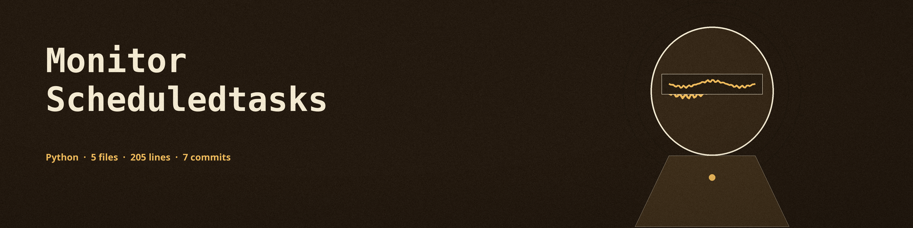

# monitor-scheduledtasks
Monitors changes to scheduled tasks, logging task name, trigger time, and associated command. Additions, removals, and updates are reported; an update is a change in trigger time, command, state, actions, or last run time. On Linux the covered sources are the current user's crontab, `/etc/crontab`, and the files in `/etc/cron.d` when present and readable, in five field form and in the `@` shorthand forms such as `@daily` and `@reboot`, with environment assignment lines handled in every crontab source. A user with no crontab is an empty baseline and polling continues; the tool exits with code 1 only when the initial retrieval genuinely fails. Other users' crontabs, systemd timers, and at jobs are out of scope and are not monitored. On Windows the task data is taken in one structured call whose JSON output is parsed directly. - Focused on System monitoring and alerts

## Install
`git clone https://github.com/ShadowStrikeHQ/monitor-scheduledtasks`

## Usage
`./monitor-scheduledtasks [params]`

## Parameters
- `-h`: Show help message and exit
- No other options are implemented: main.py defines no arguments besides `-h`, logs to the console, and polls every 60 seconds.

## License
Copyright (c) ShadowStrikeHQ
